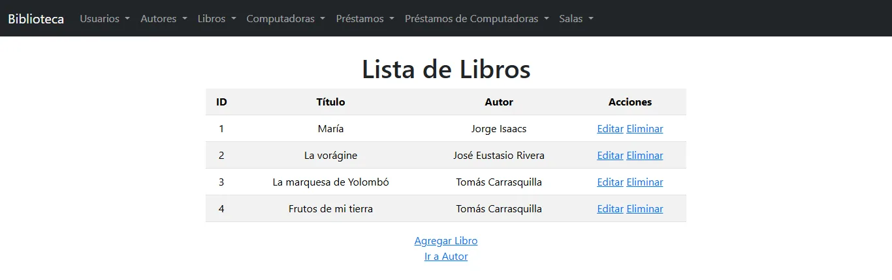

# Biblioteca

[](https://github.com/cristianyesidmquiroga-tech/Biblioteca_test/actions/workflows/tests.yml)

<details>
<summary><b>Read this in English</b></summary>

Library management system in Flask with SQLite: users, authors, books, book loans and returns, computers, computer loans and rooms. Each user gets a QR code with their data, and the app can read a QR image to find the user. Every route except the login requires a session, and passwords are stored as Werkzeug hashes.

Quick start: `cd app`, `pip install -r requirements.txt`, `flask --app run.py crear-usuario <name>` to create the first user, then `python run.py` (port 5000). With Docker: copy `.env.example` to `.env`, set `SECRET_KEY` and run `docker compose up`. Tests: `cd app && python -m pytest app/test` (45 tests, run by GitHub Actions on every pull request).

</details>



Sistema de biblioteca en Flask con SQLite: usuarios, autores, libros, préstamos y devoluciones de libros, computadoras, préstamos de computadoras y salas. Cada usuario tiene un código QR con sus datos y la app puede leer una imagen QR para encontrarlo. Todas las rutas, menos el login, piden sesión, y las contraseñas se guardan con hash de Werkzeug.

## Cómo correrlo

```
cd app
pip install -r requirements.txt
flask --app run.py crear-usuario <nombre>
python run.py
```

El comando `crear-usuario` pide la contraseña y crea el primer usuario. La app queda en `http://localhost:5000`.

Con Docker: copiar `.env.example` como `.env`, poner un `SECRET_KEY` y correr `docker compose up`.

## Estructura

```
app/
├── run.py            arranque y creación de tablas
├── config.py         base SQLite y SECRET_KEY
└── app/
    ├── models/       usuarios, autores, libros, préstamos, computadoras, salas
    ├── routes/       37 rutas en 8 blueprints
    ├── templates/    vistas con Bootstrap
    └── test/         45 pruebas con pytest
```

## Pruebas

```
cd app
python -m pytest app/test
```

GitHub Actions las corre en cada pull request y publica el resumen de resultados.

## Stack

Python 3.12, Flask, Flask-SQLAlchemy, Flask-Login, SQLite, qrcode, pyzbar, Pillow y Docker.
